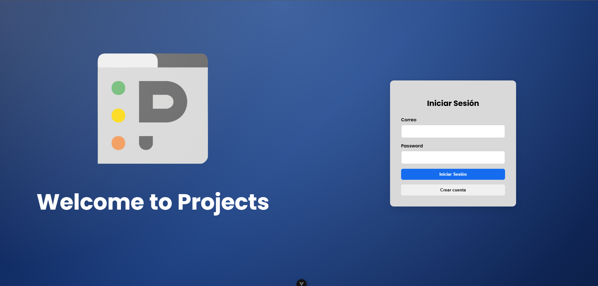
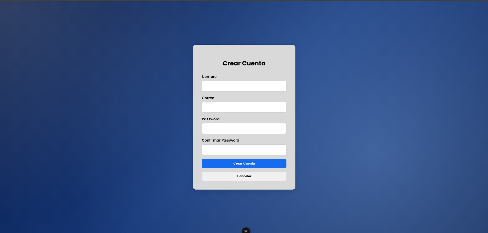
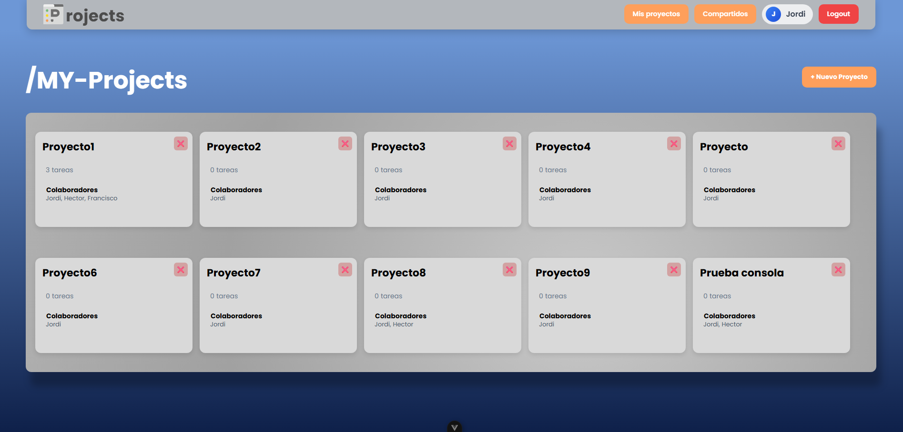
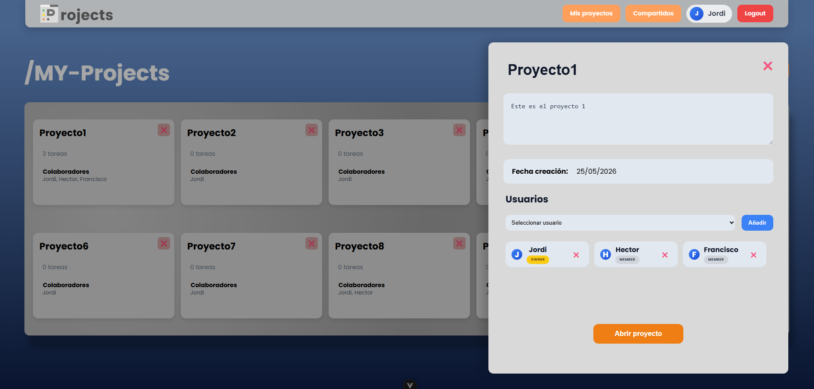
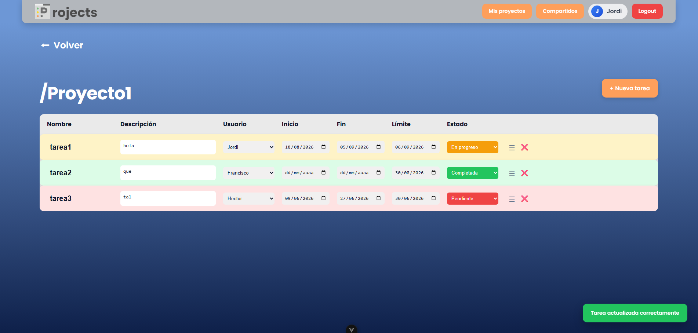
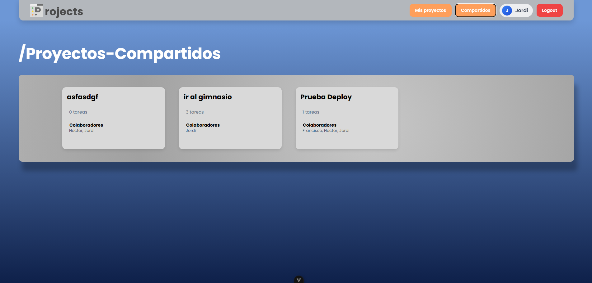
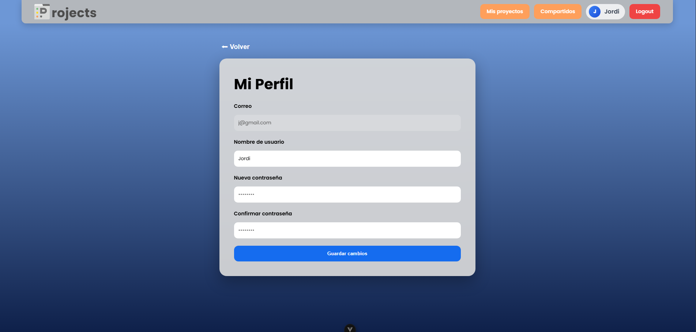
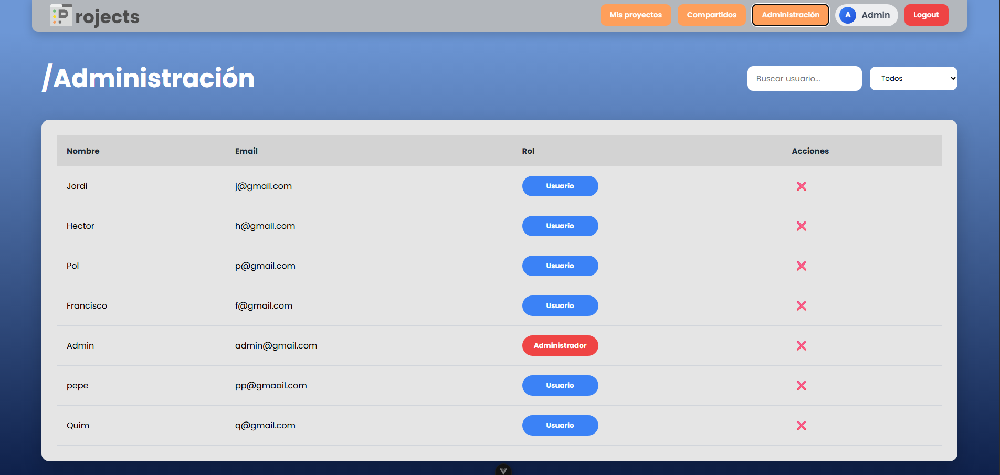

# Gestión de proyectos

Aplicación web para crear y organizar proyectos, gestionar tareas y colaborar con otros usuarios. Es un proyecto personal desarrollado durante mi formación en el ciclo de **Desarrollo de Aplicaciones Web (DAW)**.

> **Estado:** proyecto en desarrollo.

## Capturas de pantalla

A continuación se muestran las principales vistas de la aplicación:

| Inicio de sesión | Registro |
|---|---|
|  |  |

| Mis proyectos | Detalle del proyecto |
|---|---|
|  |  |

| Gestión de tareas | Proyectos compartidos |
|---|---|
|  |  |

| Perfil de usuario | Administración |
|---|---|
|  |  |

## Funcionalidades

- Registro, inicio y cierre de sesión.
- Autenticación mediante tokens con Laravel Sanctum.
- Creación, edición y eliminación de proyectos.
- Consulta de proyectos propios y proyectos compartidos.
- Incorporación y gestión de miembros en proyectos.
- Asignación de roles de propietario, administrador y miembro.
- Creación, edición, eliminación y reordenación de tareas.
- Asignación de tareas a usuarios y gestión de fechas y estados.
- Edición del perfil de usuario.
- Panel de administración para consultar, filtrar, cambiar roles y eliminar usuarios.
- Protección de rutas según autenticación y permisos.
- Interfaz con adaptación a distintos tamaños de pantalla.

## Tecnologías

| Área | Tecnologías |
|---|---|
| Backend | PHP 8.2+, Laravel 12, Laravel Sanctum |
| Frontend | Vue 3, JavaScript, Vite |
| Base de datos | MySQL |
| Dependencias | Composer, npm |

## Estructura del repositorio

```text
Gestion_proyectos/
├── backend-gestion-proyecto/   # API y aplicación Laravel
├── eina_gestio_vue/            # Aplicación frontend con Vue 3
├── Database-Backup/            # Copia de la base de datos
└── eina_gestio_vue.code-workspace
```

## Requisitos previos

- PHP 8.2 o superior.
- Composer.
- Node.js 20.19+ o 22.12+.
- npm.
- MySQL.

## Instalación y ejecución en local

Los pasos siguientes describen una configuración de desarrollo. El proyecto está dividido en backend y frontend, por lo que ambos se ejecutan por separado.

### 1. Clonar el repositorio

```bash
git clone https://github.com/Diro9807/Gestion_proyectos.git
cd Gestion_proyectos
```

### 2. Preparar la base de datos

El proyecto utiliza MySQL y espera una base de datos llamada `herramienta_gestion`.

1. Crea la base de datos en MySQL.
2. Configura las credenciales de conexión en el archivo `.env` del backend.
3. Asegúrate de disponer de un esquema compatible con el código actual antes de iniciar la aplicación.

> **Importante:** el repositorio contiene una copia de desarrollo de la base de datos con registros de prueba. No la utilices en producción ni en entornos compartidos. Las migraciones incluidas son cambios incrementales sobre tablas existentes; no constituyen por sí solas una instalación completa desde una base de datos vacía. La copia SQL debe revisarse y sanearse antes de distribuirse o utilizarse como base limpia.

### 3. Configurar el backend (Laravel)

```bash
cd backend-gestion-proyecto
composer install
```

Crea un archivo `.env` a partir de `.env.example`. Configura la conexión MySQL, por ejemplo:

```dotenv
APP_NAME="Gestión de proyectos"
APP_ENV=local
APP_DEBUG=true
APP_URL=http://127.0.0.1:8000

DB_CONNECTION=mysql
DB_HOST=127.0.0.1
DB_PORT=3306
DB_DATABASE=herramienta_gestion
DB_USERNAME=TU_USUARIO
DB_PASSWORD=TU_CONTRASEÑA
```

Genera la clave de Laravel:

```bash
php artisan key:generate
```

Instala las dependencias de frontend/Vite que utiliza el proyecto Laravel:

```bash
npm install
```

Cuando la base de datos esté preparada, aplica las migraciones pendientes:

```bash
php artisan migrate
```

Inicia el servidor:

```bash
php artisan serve
```

La API estará disponible normalmente en `http://127.0.0.1:8000/api`.

### 4. Configurar el frontend (Vue 3)

Abre una segunda terminal desde la carpeta raíz del repositorio:

```bash
cd eina_gestio_vue
npm install
```

Crea un archivo `.env` en esta carpeta con la dirección de la API local:

```dotenv
VITE_API_URL=http://127.0.0.1:8000/api
```

Inicia el servidor de desarrollo:

```bash
npm run dev
```

Abre en el navegador la dirección local que muestre Vite en la terminal.

Para generar los archivos optimizados de producción:

```bash
npm run build
```

## API

La API ofrece rutas públicas para registro e inicio de sesión y rutas protegidas mediante Laravel Sanctum.

Algunos de los endpoints disponibles son:

| Método | Endpoint | Descripción |
|---|---|---|
| POST | `/api/register` | Registro de usuario |
| POST | `/api/login` | Inicio de sesión |
| POST | `/api/logout` | Cierre de sesión |
| GET | `/api/projects` | Obtener proyectos del usuario |
| POST | `/api/projects` | Crear proyecto |
| PUT | `/api/projects/{project}` | Actualizar proyecto |
| DELETE | `/api/projects/{project}` | Eliminar proyecto |
| GET | `/api/projects/{project}/tasks` | Consultar tareas del proyecto |
| POST | `/api/tasks` | Crear tarea |
| PUT | `/api/tasks/{task}` | Actualizar tarea |
| DELETE | `/api/tasks/{task}` | Eliminar tarea |

Las rutas protegidas requieren el token de autenticación en la cabecera:

```http
Authorization: Bearer <token>
```

## Autor

**Jordi Pérez Fernández**  
Estudiante de Desarrollo de Aplicaciones Web (DAW).

- [Perfil de GitHub](https://github.com/Diro9807)
- [Repositorio del proyecto](https://github.com/Diro9807/Gestion_proyectos)

---

Proyecto personal con finalidad formativa y de aprendizaje.
